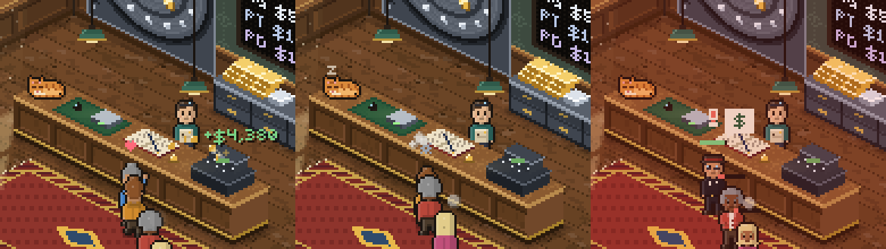

# Vault Manager

Isometric pixel art management sim of a small-town precious metal shop. Gold, silver,
platinum and palladium prices follow the real market.

## Layout

| Path | What it is |
| --- | --- |
| `project.godot` | Godot 4.3 project, 480x270 pixel-perfect viewport scaled by whole numbers |
| `autoload/market.gd` | `Market` singleton: metals, crypto, stocks and exchange rates; caches to disk, simulates when offline; formats money in the player's currency |
| `autoload/market_events.gd` | `MarketEvents` singleton: turns real price moves into news headlines and rushes of customers |
| `autoload/customers.gd` | `Customers` singleton: customer archetypes (haggler, crypto bro, collector, shady seller) and the regulars' stories |
| `autoload/shop.gd` | `Shop` singleton: cash, reputation, stock and the day's results; stock is valued at live prices |
| `autoload/day.gd` | `Day` singleton: day phases (morning, open, closing, after hours), the week, bills and the day's ledger |
| `autoload/progress.gd` | `Progress` singleton: the four shop tiers, upgrades and their effects |
| `autoload/wholesaler.gd` | `Wholesaler` singleton: the morning wholesaler's lots and prices (spot plus a markup that shrinks as the shop grows) |
| `autoload/rivals.gd` | `Rivals` singleton: the rival shops in town (Sterling Bullion and Lucky's Pawn), how customers choose between them and you, the rivals' morning moves and your answers; saved with the game |
| `autoload/staff.gd` | `Staff` singleton: the clerk and the guard you can hire, their signing fees, daily wages and effects |
| `autoload/save_game.gd` | `SaveGame` singleton: three save slots (`user://save_1.json` to `save_3.json`), saved every morning and at the end of each day; an old `save.json` becomes slot 1 |
| `autoload/settings.gd` | `Settings` singleton: volume for the Master, Music and SFX buses and fullscreen, saved in `user://settings.cfg` |
| `autoload/tutorial.gd` | `Tutorial` singleton: remembers whether the guided first day and the bench intros have been shown; saved with the game |
| `autoload/records.gd` | `Records` singleton: the long-term ledger (lifetime totals, best days, streaks) and the 24 achievements; saved with the game |
| `autoload/music.gd` | `Music` singleton: plays and crossfades the music, rendering each track once on a thread and caching it in `user://music_cache/` |
| `items/bullion_item.gd` | `BullionItem` resource: value computed from weight x purity x live price, plus the art settings for its coin face |
| `items/jewellery_piece.gd` | `JewelleryPiece`: a ring, chain, bracelet or pendant, what the customer claims it is and what it really is (plated, under-karat, a better karat than claimed, or a CZ, glass or moissanite stone) |
| `items/bullion_bar.gd` | `BullionBar`: the bars customers sell (1 oz to 1 kilo, gold, silver and platinum), the six kinds of fake bar, what the ultrasound and XRF gun read, and the ledger of serial numbers you have bought |
| `items/counterfeit.gd` | The four kinds of fake (plated steel, brass, copper-nickel clad, tungsten core) and what each does to the readings |
| `data/coins/*.tres` | Real coin specs (weight, purity, diameter, thickness) used by the testing minigame |
| `scenes/menu/` | The title screen (main scene: Continue, New game, Settings, Quit) and the pause menu |
| `scenes/shop/` | The isometric shop: room renderer, customers, HUD, morning/upgrades/summary panels and the day loop (main scene); `rush_hours.gd` holds the busy hours and the till rules, `security.gd` the hold-ups and burglar crews, `shop_fx.gd` the particles and customer reactions |
| `scenes/tutorial/coach.gd` | The coach: the cards of the guided first day (with three scripted customers) and the bench intros |
| `scenes/coin_test/` | The coin testing minigame: scale, calipers, ping, magnet and loupe |
| `scenes/jewellery_test/` | The jewellery appraisal: scale, touchstone and acids, thermal diamond tester, magnet and loupe |
| `scenes/bar_test/` | The bar test: scale, calipers, ultrasound flaw detector, XRF gun and loupe |
| `scenes/trading_desk/` | The trading desk minigame on the morning panel; `desk_session.gd` holds the tapes, trades, limit and hedging |
| `scenes/vault/` | The vault lock-up minigame at closing time; `vault_layout.gd` holds the packing and break-in rules |
| `art/` | Code-drawn pixel art: bitmap font, iso projection, shop, people (walk cycle, back view, moods), coin, jewellery, bar, vault, trading desk and title screen painters. `shop_ambience.gd` adds the sunbeam, dust, neon sign and shop cat; `bench_art.gd` the testing benches' wood, housings and lamp light. No image files |
| `audio/sfx.gd` | Sound effects synthesised at runtime, including each coin's ring (`jewellery_sfx.gd` adds the touchstone, acid and tester sounds, `bar_sfx.gd` the gel, ultrasound and X-ray sounds, `shop_sfx.gd` the shop floor: door bell, register, coin clinks, service bell and customer voices) |
| `audio/music_synth.gd` | The music, synthesised at runtime: a music-box title theme and a slow jazzy shop loop |
| `ui/ui_theme.gd` | Pixel UI theme (font, panels, buttons, sliders) |
| `ui/settings_panel.gd` | The settings page shared by the title screen and the pause menu |
| `ui/save_slots_panel.gd` | The save slots page on the title screen: play, start or delete each slot |
| `tests/smoke_test.tscn` | Headless checks: run `godot --headless --path . res://tests/smoke_test.tscn` |
| `tests/balance_sim.tscn` | Balance check: bot players run the real shop for many days (see Balance below) |
| `price-service/` | Cloudflare Worker that polls the metals API and serves `GET /prices` |
| `prototype/index.html` | Single-file browser prototype (simulated prices, coin testing minigame) |

## Play on Windows (no Godot needed)

Every change merged into `main` builds a fresh Windows version automatically.

1. Open https://github.com/AlexAlphaK/Vaultmanager/releases/latest
2. Under **Assets**, click **VaultManager-windows.zip** to download it.
3. Right-click the zip, choose **Extract All**, then double-click **VaultManager.exe**.
4. The first time, Windows may say "Windows protected your PC" because the game is not
   signed. Click **More info**, then **Run anyway**.

Saves and settings live in `%APPDATA%\Godot\app_userdata\Vault Manager`, so a new download
keeps your shop. The build is made by `.github/workflows/windows-build.yml` from the
"Windows Desktop" preset in `export_presets.cfg`; to export by hand in the editor use
**Project > Export > Windows Desktop**.

## How to play

The game opens on the title screen. **Continue** picks up the shop you played last. There are
three save slots, and each one saves every morning and again at the end of the day, so quitting
on the summary carries on with the next morning. **Save slots** lists them with their day, shop,
cash and save time, to play one, start a new shop in an empty one, or delete one (click twice).
**New game** starts day 1 in the first empty slot and never erases a save, and
**Settings** sets the currency, the volume of everything, music and effects, and fullscreen.
In the shop, **Esc** or the **Menu** button pauses the game. **F11** toggles fullscreen anywhere.

A new game starts with a **guided first day**. Cards walk you through the ticker and your
margins, then three customers: June sells you genuine Silver Eagles (test them with the scale and
calipers, then buy), Slick tries to sell you plated steel fakes (the magnet catches them), and
Priya buys silver from your vault. The shop clock waits while the cards are up. Then the shop is
yours until closing, with one more card for the vault lock-up and one on the summary. The first
time a jewellery piece or a bullion bar comes in, its bench opens with a short intro.
**Skip tutorial** on any card turns all of this off. What you've seen is saved with the game.

Customers queue at the counter. Sellers bring coins, buyers want coins from your vault.

- **Test coin** opens the bench. Press 1-5 or click the tools: **Scale** (weight), **Calipers**
  (diameter and thickness), **Ping** (listen to the ring and watch the scope), **Magnet** and
  **Loupe** (move the mouse over the coin). Compare each reading with the spec column, then
  call it **Genuine** or **Fake**. Esc goes back to the counter.
- Fakes you buy are caught by the assay lab a little later, and cost you the money and reputation.
- Some sellers bring **jewellery** instead. **Examine** opens the appraisal bench. Press 1-5 or click
  the tools: **Scale** (true weight), **Acid** (rub a streak on the touchstone, then click a bottle or
  press Q-Y to drop 10K, 14K, 18K, 22K, silver or platinum acid: the streak survives acids up to its
  karat and base metal fizzes), **Tester** (thermal probe on the stone; moissanite fools it),
  **Magnet** (plated steel snaps, a chain's clasp spring pulls a little) and **Loupe** (read the
  hallmark, look for plating wear, inclusions, scuffs, bubbles and doubled facet edges).
  Then set the **Metal** grade (G) and whether the **Stone** is a diamond (D); your offer follows
  from your grading at today's prices. Bought pieces go to the refiner, who pays what they are
  really worth, so a wrong appraisal shows up in the log a few seconds later.
- Other sellers bring a **bullion bar**. **Test bar** opens the bar bench. Press 1-5 or click the tools:
  **Scale** (a real bar weighs its stated weight, up to 0.1% over, never under), **Calipers** (length,
  width and an edge-on thickness view), **Ultrasound** (move the probe over the bar with the mouse; the
  flaw detector shows the echo off the bottom of the bar, which must land inside the gate, and the
  scan map marks every spot you checked), **XRF** (an X-ray gun that reads what the surface is made
  of; buy the XRF analyzer upgrade first) and **Loupe** (read the marks and the serial number).
  Tungsten is almost exactly as heavy as gold, so a tungsten bar under gold plating or a gold bar
  with a tungsten slug inside passes the scale. Sound travels faster through tungsten: the echo
  comes back early, and over a hidden slug a second echo shows up. Slugs sit in the middle of the
  bar, so sweep it all over. Fakers also stamp the serials of real bars: the panel tells you when
  a serial is one you have bought before. Bought bars go to the bullion dealer, who tests them again.
  The Bullion dealer account upgrade gets you a better price for genuine bars.
- The **-/+** buttons set what share of melt you pay sellers and the premium you charge buyers.
  Push too far and customers walk.
- **Closing time** opens the vault lock-up. Your stock and the till's cash spill onto the counter
  tray as coin tubes, coin boxes, monster boxes, cash straps and the customer ledger. Drag them
  into the wall safe and the floor safe before the lights go out (right-click or R turns a piece,
  Enter locks up early). Anything left on the tray raises the break-in risk, and so does
  locking up late. Three kinds of burglars come: **smash-and-grab kids** carry off the three
  most valuable pieces on the tray and never touch the safes; a **safecracking crew** takes the
  whole tray and cracks the wall safe 40% of the time; **professionals** (from Main Street up)
  crack it 80% of the time. Nobody gets into the floor safe, so the best stock belongs there. Losing the ledger costs reputation. Moving to a bigger
  shop widens the floor safe, the Second safe upgrade adds a shelf to the wall safe, and the
  alarm upgrades cut the break-in odds. To try it on its own,
  open `scenes/vault/vault.tscn` in Godot and press F6.
- **Rush hours.** Every day has a lunch rush (11:45) and an after-work rush (15:45); Saturdays
  add a morning crowd and Sundays only have lunch. The clock turns orange and says RUSH. In a rush
  customers pour in, a full queue turns people away at the door, and the clock keeps running while
  you are at a testing bench, so the queue loses patience while you test. A strip at the top of the
  bench shows who is waiting. Cash from sales piles up in the **till** (next to IN THE VAULT on the right);
  past the limit it flashes and a thief may grab it, so press **To vault** to lock it away. That
  takes you off the counter for 3 seconds.
- **Staff.** Hire them on the Upgrades page in the morning. **Benny the clerk** works a second
  till at the end of the counter: he sells coins to buyers at your price (sellers, who need
  testing, stay with you), and sends anyone who wants a better price back to your queue.
  **Rhonda the guard** stands by the door: break-ins drop by a third, till snatches almost
  stop, and she stops 70% of armed robbers before they reach the counter. Each costs a signing fee once and a daily wage at closing time, which rises as the shop
  grows. **Let go** takes them off the payroll.
- **Hold-ups.** From day 2, now and then a man in a cap joins the queue. At the counter he pulls
  a gun and half the queue runs for the door. **Hand over till** loses the till's cash and nothing
  else. **Panic button** sets off the alarm: it scares him off 45% of the time (more with the
  alarm, the time lock and the guard, up to 90%), but if it fails he takes the till and sweeps the
  best coins out of the display case. Wait too long (8 seconds) and he does that anyway. A full
  till draws more robbers, and so does a bigger shop. **Security cameras** (an upgrade) cut
  hold-ups by 40% and the police get back a third of what robbers and burglars take.
  The rules live in `scenes/shop/security.gd`.
- **Morning wholesaler.** Press **Restock** on the morning panel to buy coins before you open,
  at spot plus 3% (less in bigger shops). Each morning brings a few gold and platinum coins and
  a stack of silver; **+1** buys one, the second button buys a bulk lot. Walk-in sellers are
  still the cheaper way to stock up, so restock what buyers keep asking for, and leave cash in
  hand for the sellers.
- **Trading desk.** Build the trading desk room (Bullion house, $75,000) and a **Desk** button
  joins the morning panel. One session a morning: a minute-long trading day (09:00 to 17:00) for
  gold, silver, platinum and two each of the live crypto and stocks. Each tape replays a day that
  ends near today's live price, so the board's real 24-hour move is your edge, but never a sure
  thing. Pick a row (1-7 or click), **Buy** (B) to go long, **Sell** (S) to go short, **Close**
  (C) to get out, all within the desk's limit ($20,000 times your deal size). **Hedge vault** (H)
  shorts the metal in your vault ounce for ounce with up to half the limit, so a falling price
  costs the vault on paper but pays at the desk. At the closing bell everything closes and the
  profit or loss goes on today's ledger. The rules live in `scenes/trading_desk/desk_session.gd`.
- **Rival shops.** You are not the only dealer in town. **Sterling Bullion Co.** across the street
  is the big established dealer, and **Lucky's Pawn & Loan** across the side street pays far
  less for metal but asks no questions. Every customer weighs the shops by what they pay or
  charge (your **Pay sellers** and **Charge buyers** board) and by their stars. When your shop
  looks worse than a fair share, some customers cross the street before they reach your door
  (the log says where they went and why); when it looks better, word spreads and customers come
  up to 15% faster. Lucky's draws shady sellers and some jewellery away from you. Each morning
  Sterling reprices against you, cutting a point when you are winning and taking it back when
  it is, and the rivals make moves: a **price war** (Sterling pays 92% and sells at +3% for
  three days), a radio **ad blitz**, a one-star **smear** review (it can't touch a 4-star shop),
  a **fencing** racket at Lucky's, or a **clearance** sale next door. Press **Town map** on the
  morning panel to see the crossroads, each shop's stars, prices and net worth, your place in
  town, and today's news. Your answers: a **newspaper ad** (more customers pick you for three
  days), **Beat Sterling** (sets your board a point better than theirs) and, while Lucky's is
  fencing, **Tip off police** (a raid shuts it for five days and earns you stars). The rivals'
  net worth grows every day, and passing them is how you become the biggest store in town. The
  numbers live in `autoload/rivals.gd`, the map in `art/town_art.gd`.
- Every price comes from the live market feed, so the same coin is worth more or less from one
  day to the next. The LED board on the back wall shows today's spot prices.
- **The ledger.** The **Ledger** button on the morning panel shows your lifetime record: deals,
  money bought and sold, profit, fakes caught and missed, losses to thieves, your highest net
  worth and stars, your profit streak and your three best days. **Achievements** lists 24 goals
  (hover one to see how to earn it and how close you are). Earning one pops up in the log, and
  the day's summary lists what you earned and tells you when you've had your best day yet.

## Customers

Not everyone who walks in is the same. The counter card tags the ones worth watching:

| Who | What they do |
| --- | --- |
| Everyday walk-ins | About half will come down (or up) a point if you hold firm |
| **Hagglers** | Open well above (or below) their real number, then come round a step each time you hold firm. They name their counter, so you can meet them with the -/+ buttons or keep pushing. Every push costs patience |
| **Crypto bros** | Big gold orders and short patience. They buy after crypto rallies, sell cheap after crashes, and turn up in Bitcoin rushes |
| **Collectors** | Want one exact coin and pay 12-18% over spot for it |
| **Nervous sellers** | Suspiciously cheap and in a hurry. Most carry fakes |

**Regulars** come back every couple of days, and each has a short story told over their visits:
Grandpa Lev selling his late wife's coins, Mrs. Okafor saving silver for her granddaughter's
college fund, Chad the crypto trader riding his ups and downs, Dr. Vance building a museum
display, and Vinnie, who keeps trying to sell you fakes until Detective Ruiz pays a visit.
Fair deals build their loyalty (and slightly better prices); finish a story for a reputation
boost or a reward. Turn a regular away twice and they find another shop. If a regular wants a
coin you don't have, they come back for it later. Story moments show up in the end-of-day
summary, and everything is saved. The stories live in `Customers.REGULARS`.

## Market events

Big real-world moves make the news, and the news brings customers. A red or green NEWS strip
runs over the shop for about a minute, and most new customers come because of the story:

| Real move | Headline | Who walks in |
| --- | --- | --- |
| Gold down 1% in a day | Gold slides | Panic sellers who accept less than usual |
| Gold up 1% | Gold jumps | Sellers cashing in, holding out for more |
| Silver up or down 2% | Silver squeeze / Silver on sale | Silver buyers, paying extra in a squeeze |
| Platinum up 2% | Platinum pops | Platinum sellers |
| Bitcoin down 4% in 24h | Bitcoin crashes | Crypto converts buying gold at a premium |
| Bitcoin up 4% | Bitcoin soars | Sellers raising cash to chase crypto |
| Dogecoin up 10% | Dogecoin moons | Lucky winners buying gold |
| S&P 500 down or up 1.2% | Stocks tumble / Stocks rally | Safe-haven gold buyers, or sellers moving into shares |
| NVIDIA down 5% | Chip stocks plunge | Tech money buying silver |

Metals compare with the price about a day ago (the price service keeps a day and a half of
metal quotes and sends `metals_change`). Crypto and stocks use the provider's daily change.
A story does not repeat until its move has faded. Triggers and effects live in
`MarketEvents.EVENTS`. In a debug build (playing from the editor), **F9** plays the next event.

## Run

1. Open the folder in Godot 4.3 or later and press Play.
2. Without the price service running, the game starts in "simulated" mode from seed prices.
3. To use live prices, deploy `price-service/`:
   - `npx wrangler kv namespace create PRICES` and paste the id into `wrangler.toml` (only when deploying to a new Cloudflare account)
   - Set the API keys as secrets (never commit them; for local `wrangler dev`, put them in `price-service/.dev.vars`, which is git-ignored):
     `npx wrangler secret put METALCHARTS_KEY`, `COINGECKO_KEY` (optional), `FINNHUB_KEY`
   - `npx wrangler deploy`. `Market.service_url` points at the deployed worker; change it if you deploy your own.

Design doc: https://claude.ai/artifact/VqviQgHanNwibT95FhXgLV

## Balance

`tests/balance_sim.tscn` has three bots (novice, average, expert) play the real shop scene
headless: they test or skip the bench, misread some fakes, haggle with the -/+ buttons, grade
jewellery, pack the vault, empty the till, hire staff, buy upgrades and restock from the
morning wholesaler (the average and expert bots also tip off the police about Lucky's).
Everything else, the rival shops included, is the
game's own code. It prints when each bot reaches each tier, net worth and stars over time, and
where the money came from and went.

    godot --headless --path . res://tests/balance_sim.tscn -- --runs=6 --days=100

Options: `--bots=novice,average,expert`, `--runs=N` seeds per bot, `--days=N`, `--seed=N`, and
`--csv=PATH` for one row per bot per day. A 100-day run takes a few minutes per bot.
The knobs it tunes live in `Shop.REPUTATION`, `Customer.FAKE_ODDS` / `FAKE_ODDS_MAX` and the
customer mix constants, `JewelleryPiece.FRAUD_ODDS`, `Wholesaler.MARKUP` / `LOT_RANGE`, `Progress.TIERS`, `RushHours` and the `Rivals` constants
(`PRICE_WEIGHT`, `STAR_WEIGHT`, `FAIR_SHARE`, `MAX_DIVERT`, `MAX_BOOST`, `SHOPS`). It also prints
how many customers went to a rival and your median place in town.

The shop is open for `Shop.DAY_SECONDS` (120 s of clock, 09:00 to 17:00; the clock stops at
the testing benches outside rush hours). Customers arrive per second, not per day, so the daily
bills (`Progress.TIERS` rent and upkeep, `Progress.INSURANCE_RATE`, `Staff.ROLES` wages,
`Day.OVERDRAFT_RATE`) are sized for that length: change the day length and scale them with it.

## Data sources

| Data | Provider | Free tier (check before launch) | Refresh |
| --- | --- | --- | --- |
| Gold, silver, platinum, palladium | MetalCharts | ~200 calls/month, attribution link required | every 4 hours |
| Crypto (BTC, ETH, SOL, DOGE) | CoinGecko demo plan | free key, ~30 calls/min, attribution required | every 5 minutes |
| Stocks (SPY, AAPL, NVDA, TSLA) | Finnhub free plan | free key, ~60 calls/min | every 5 minutes |
| Exchange rates | Frankfurter (ECB reference rates) | no key | every 4 hours (ECB updates daily) |

## Currency

Everything runs in USD internally. `Market.format_money()` converts for display. The default
currency comes from the device locale (e.g. `de_DE` shows euros); players can change it in
Settings, and the choice is saved in `user://settings.cfg`.

## Sound

Every sound is made in code. Effects play on the **SFX** bus and music on the **Music** bus;
both feed **Master**, and `Settings` creates the buses at launch so there is no bus layout file.
`MusicSynth` renders each track as a seamless loop (a second or two of work), so `Music` does it on
a thread the first time and keeps the result in `user://music_cache/`. If you change
`music_synth.gd`, bump `Music.CACHE_VERSION` so players get the new render.

On the shop floor `ShopFx` (`scenes/shop/shop_fx.gd`) adds the life between the rules: coins arc
across the counter on every deal and the money pops up over the till, each customer rings the
service bell and speaks in their own little made-up voice (`ShopSfx.voice`, pitched from their
seed), the impatient sweat and steam, anyone who storms out leaves in a puff of steam, a caught fake
sparkles, and a hold-up flashes the room red and shakes it. It only listens to `Shop.noted`,
`Shop.logged` and the shop's `customer_left` signal, so the rules never depend on it.
`ShopSfx.warm_up()` renders the common sounds when the shop opens so the first customer doesn't
stutter.

## Feed states

- `live`: a fresh quote arrived from the price service.
- `cached`: the service is unreachable; the last real quote is used.
- `simulated`: no real quote for over 24 hours (or never); prices follow a random walk with realistic volatility.
